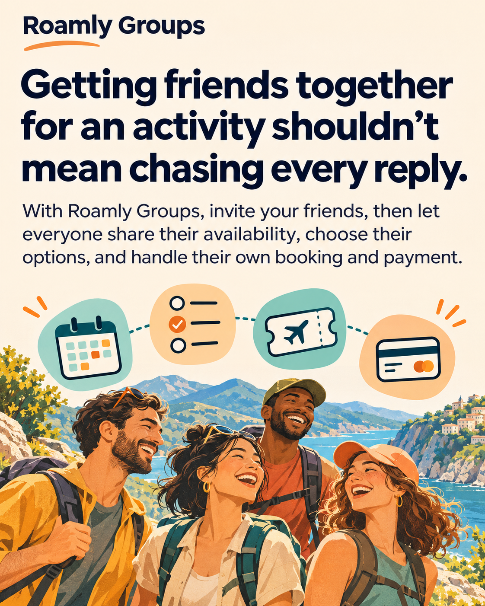

# Messaging Pillars · Roamly Groups

## 1. From/To market shift

- **From, life before:** The person who suggests an activity becomes everyone’s coordinator—inviting friends, finding a shared date, making bookings, and collecting money, sometimes paying upfront and chasing reimbursement.
- **To, life after:** The initiator shares an idea and invites friends. Each friend indicates availability so the group can settle on a shared date, selects their activity options, and books and pays for their own participation.

## 2. Audiences

- **Number of audiences that need their own message:** 2
- **Why you picked this number:** Initiator: Bring friends together without taking on everyone’s arrangements and payments.
Attendees: Have control over their own choices and payment, rather than having someone else arrange everything for them.

## 3. Messaging pillars

### Audience 1: Initiator
- **Value prop:** Bring friends together for an activity while saving time and energy—and avoiding the frustration of coordinating everyone’s arrangements.
- **Capabilities:** After the initiator invites friends, Roamly Groups guides the group through sharing availability, settling on a shared date, choosing activity options, and completing individual bookings and payments. Each attendee handles their own steps, so the initiator doesn’t have to manage every response.
- **Evidence — working estimate, not measured:** For a six-person outing, coordinating the five invited friends at an estimated 20–30 minutes each represents 100–150 minutes of the initiator’s time. Roamly Groups could reduce that burden by guiding attendees through their own availability, selections, bookings, and payments. Validate the actual time saved and frustration reduced in a pilot.

### Audience 2: Attendees / invitees
- **Value prop:** Join your friends while keeping control of your own choices, booking, and payment. Choose the activity options that suit you and pay directly, without relying on someone else to arrange everything or paying them back afterward.
- **Capabilities:** Roamly Groups guides each attendee through indicating availability so the group can settle on a shared date, selecting activity options, and booking and paying for their own participation. Each person completes their own steps within the booking deadline and available provider options.
- **Evidence — fictional illustration for this exercise, not actual pilot results:** In an imagined pilot with 30 attendees across five group outings, 24 of 30 completed their selections, booking, and payment without help from the initiator. Twenty-five reported feeling more in control of their choices and payment than when one friend managed the booking for everyone.

## 4. Copy across three surfaces

- **Homepage headline:** “Bring your friends together. Spend less time sorting out the details.”
Leads with: The value proposition. It puts the desired outcome first—getting friends together—then names the coordination burden Roamly Groups aims to reduce.
- **Social post:** “Getting friends together for an activity shouldn’t mean chasing every reply. With Roamly Groups, invite your friends, then let everyone share their availability, choose their options, and handle their own booking and payment.”
Leads with: The coordination frustration, followed by the capabilities. It starts with a recognizable problem and explains how each friend takes responsibility for their own steps.
- **Email subject line:** “One group outing. Everyone handles their own booking.”
Leads with: The capability of individual booking. It gives the initiator a specific reason to care: bringing the group together comes with fewer arrangements to manage personally.

## 5. AI-generated visual asset

- **Selected surface:** Social post, aimed at the initiator.
- **Why this variation:** It names the frustration of chasing replies and shows how friends take responsibility for availability, options, booking, and payment.
- **Asset:** [Roamly Groups social post](social-post.png)

## 6. Asset review — AI review, not a human peer test

- **Who is this built for?** The friend who initiates a local group activity and otherwise ends up chasing responses and coordinating everyone.
- **What does the product do?** Helps an initiator invite friends and lets each attendee share availability, choose options, and handle their own booking and payment.
- **What makes it trustworthy?** The copy explains a concrete workflow, but the asset contains no measured outcomes, customer testimonials, or other independent evidence. Its effectiveness and credibility still need validation with real users.
- **Review outcome:** Retain the specific workflow and the focus on initiator relief. Keep the working time estimate and fictional pilot results out of the customer-facing asset. The travel imagery is broader than the one-local-activity positioning; test whether viewers understand the intended scope.

## 7. Validation and promise boundaries

The initiator time estimate is an assumption about the existing coordination burden, not measured time saved by Roamly. The attendee pilot figures are fictional examples created for the classroom exercise and must not be presented as real research. Validate time saved, independent completion, and perceived control with actual initiators and attendees. Payment deadlines, available options, changes, cancellations, and refunds remain subject to provider rules; the message does not promise unlimited flexibility or deferred payment.
